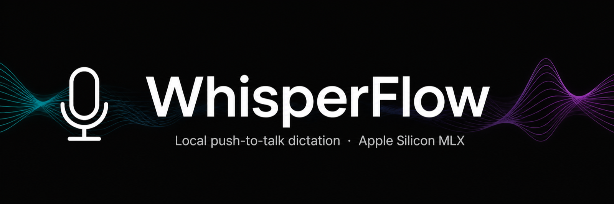
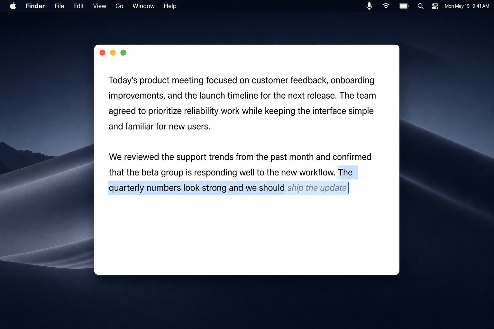
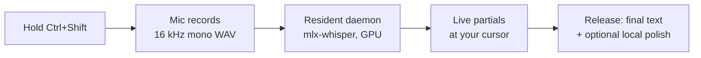

# WhisperFlow — Bishal Edition


**Push-to-talk dictation for macOS — 100% local, powered by mlx-whisper on Apple Silicon.** Hold a hotkey, speak, release. Text lands at your cursor in any app. No cloud, no subscription.

This is **WhisperFlow — Bishal Edition**, a fork of [mooe20-commits/WhisperFlow](https://github.com/mooe20-commits/WhisperFlow) (MIT), maintained by [Bishal Mistri](https://github.com/bmistri321). It adds the changes below on top of the original v0.9.9. The original copyright notice is kept in [LICENSE](LICENSE).

This repo holds the **source** — the Swift app, the daemon scripts and the build scripts. It does **not** contain a prebuilt app. Build it yourself below, in 3 steps.

<p align="center">
  
</p>

## Contents

- [Get it](#get-it)
- [What you get](#what-you-get)
- [Original vs this edition](#original-vs-this-edition)
- [Install — 3 steps](#install--3-steps)
- [Usage — the short version](#usage--the-short-version)
- [How it works — the short version](#how-it-works--the-short-version)
- [FAQ](#faq)
- [Verified](#verified)
- [Limitations — read this](#limitations--read-this)
- [Files](#files)
- [License](#license)

## Get it

```sh
git clone https://github.com/bmistri321/WhisperFlow-Bishal-Edition.git
cd WhisperFlow-Bishal-Edition
```

| | |
|---|---|
| Version | v0.9.9 (Bishal Edition, on top of original v0.9.9) |
| Platform | macOS 13.0+ (Ventura or later), Apple Silicon (M1/M2/M3/M4) |
| Engine | mlx-whisper (MLX, runs on the GPU) |
| Default model | small.en (models ~0.8–1.4 GB, download on first use) |
| Hotkey | **Ctrl+Shift** in this build (the original README says Ctrl+Option) |

> No prebuilt app is included in this repo. Build it with `./build.sh install` below — it copies the app to `/Applications`.

## What you get

| | |
|---|---|
| ✅ **Hold, speak, release** | Press the hotkey anywhere in macOS, speak, release — your words are transcribed on-device and typed directly at your cursor. |
| ✅ **Live partials** | Text streams in at the cursor *while* you talk, not just at the end. |
| ✅ **Near-instant dictation** | A resident transcription daemon means the model loads once, so dictation is ~1 second. |
| ✅ **RAM only when you dictate** | The daemon unloads the Whisper model after 5 minutes idle and frees the RAM, while the daemon itself stays alive (~10 MB). The next dictation reloads the model first (~2–3 seconds extra), then it's fast again. |
| ✅ **Local LLM polish** | Optional cleanup with a local Ollama model (`hf.co/Abiray/MiniCPM5-2B-heretic-abliterated-GGUF:Q4_K_M`), no API key, no cloud. Fixes fumbles and self-corrections, adds a gap after the dot, and never invents text. |
| ✅ **Black recording pill** | A small bottom-centre pill with a live waveform while you speak, then a calm black pill with white "Cleaning up…" while the text is polished. |
| ✅ **Filler-word removal** | uh / um / ah / erm / hmm stripped automatically. |
| ✅ **Grammar correction** | Sentence capitalization + smart punctuation (question-aware). |
| ✅ **Fully offline** | Audio never leaves the machine. |

<p align="center">
  
</p>
<p align="center"><em>Dictating in real time — partial text streams in at the cursor before you even release the hotkey.</em></p>

## Original vs this edition

| | Original WhisperFlow | Bishal Edition |
|---|---|---|
| Hotkey | Ctrl+Option | **Ctrl+Shift** |
| Transcription daemon | None — the daemon engine always failed | **Resident daemon** (`scripts/wf-transcribe-daemon`, with the `scripts/wf-transcribe` subprocess wrapper) |
| Model loading | Loaded per call | **Loads once**, unloads after 5 minutes idle |
| LLM polish | — | **Local Ollama polish**, no API key, no cloud |
| Recording pill | — | **Black pill** with live waveform, then "Cleaning up…" |
| Signing | — | **Signed with a "WhisperFlow Dev" certificate** — rebuilds no longer break the Accessibility grant |
| Model location | Internal disk | **Models can live on an external drive** via `HF_HOME` (Whisper) and `OLLAMA_MODELS` (Ollama) |

## Install — 3 steps

1. **Install the transcription backend**
   ```sh
   pip install mlx-whisper          # models (~0.8–1.4 GB) download on first use
   ```

2. **Build & install the app**
   ```sh
   git clone https://github.com/bmistri321/WhisperFlow-Bishal-Edition.git
   cd WhisperFlow-Bishal-Edition
   ./build.sh install               # builds and copies to /Applications
   ```

3. **Grant permissions BEFORE first launch**
   ```sh
   ./build.sh permissions           # prints step-by-step instructions
   ```

| Permission | Where | Why |
|------------|-------|-----|
| Microphone | System Settings → Privacy & Security → Microphone | Record audio |
| Speech Recognition | System Settings → Privacy & Security → Speech Recognition | Audio input |
| Accessibility | System Settings → Privacy & Security → Accessibility | Global hotkey + text injection |

> ⚠️ **Accessibility is critical** — without it the CGEvent tap silently fails and the hotkey does nothing.

> **Signing:** this edition is signed with a "WhisperFlow Dev" certificate — see `create_cert.sh`. Never rebuild ad-hoc unsigned, or macOS will ask for Accessibility again.

## Usage — the short version

1. Launch WhisperFlow — a mic icon appears in the menu bar
2. Place your cursor anywhere, in any app
3. **Hold Ctrl+Shift**, speak naturally — partial text appears at the cursor
4. **Release** → final text lands at the cursor

**Continuous mode:** double-tap the hotkey within 1 s → record hands-free; press any key to commit, Esc to cancel. Auto-commits after 5 minutes.

**Settings** (menu bar icon → Settings…): streaming cadence · partials on/off · engine · model · grammar mode · filler removal · hotkey choice.

## How it works — the short version

Hold the hotkey → the mic records → the resident daemon transcribes on-device with mlx-whisper on Apple Silicon → the text is injected at your cursor, with live partials while you talk and a final commit on release. A local Ollama model optionally polishes the text afterwards.



<details>
<summary><b>Full technical detail</b></summary>

### The pipeline

```
Ctrl+Shift held (or double-tap for continuous)
│
▼
HotkeyManager            CGEvent tap (global) + fast poll
│
▼                        WAV · 16 kHz mono PCM
AVAudioEngine            mic tap, BT A2DP→HFP route warm-up
│
▼                        partial flush every N seconds (configurable)
TranscriptionController  streaming WAV writer, byte-offset tracking
│
▼                        [daemon: <100 ms | subprocess: 1.5–2 s]
TranscriptionDaemon      Unix-socket client ↔ resident whisper server
│
▼                        Apple Silicon MLX (GPU)
mlx-whisper              local model — base.en / small.en
│
▼
TextInjector             AX in-place replace (partials)
                         keystroke injection or pasteboard+⌘V (final)
```

### Text injection — two strategies

| Phase | Method | Works in |
|-------|--------|----------|
| During recording | AX in-place partial replacement at cursor | Native apps (TextEdit, Notes, Mail, Safari) |
| On commit | Keystroke injection (pasteboard-free) or pasteboard + ⌘V | Every app, incl. Electron/Chromium |

In apps where AX write fails (Telegram, Slack, VSCode, Discord), partials are skipped silently — final injection still works everywhere, and the pasteboard-free path keeps your clipboard untouched.

### Engine comparison

| Engine | Per-call latency | Idle RAM | Model |
|--------|------------------|----------|-------|
| `daemon` (default) | **near-instant** (<100 ms typical) | ~1.5 GB resident, released on quit | resident |
| `subprocess` | 1.5–2 s (model load dominates) | ~0 MB | loaded per call |

Note: in the Bishal Edition the daemon also unloads the model after 5 minutes idle, so idle RAM drops while the daemon itself stays alive (~10 MB) — the next dictation reloads the model first (~2–3 seconds extra).

### Project layout

```
Sources/WhisperFlow/
├── WhisperFlowApp.swift          @main, SwiftUI scene (menu-bar only)
├── AppDelegate.swift             lifecycle, menu bar, logging
├── HotkeyManager.swift           CGEvent tap + poll, PTT & continuous modes
├── TranscriptionController.swift WAV writer, partial flush, pipeline
├── TranscriptionDaemon.swift     Unix-socket client for resident engine
├── TextInjector.swift            AX partials + keystroke/pasteboard final inject
├── GrammarCorrector.swift        mode-aware punctuation + question guard
├── FillerWordCleaner.swift       sound-only filler regex
├── MicEnergyTracker.swift        per-session RMS diagnostics (BT/A2DP issues)
├── PermissionsChecker.swift      mic/speech/accessibility pre-flight
└── SettingsWindow.swift          SwiftUI settings (tabbed)
```

~4k lines of Swift, zero compiler warnings. See [CHANGELOG.md](CHANGELOG.md) for release history.

Diagnostics log at `~/Library/Logs/WhisperFlow/app.log` (5 MB rotating, user-only perms); `WF_DEBUG=1` for verbose output.

</details>

## FAQ

**Do I need the internet?**
No. Transcription and polish are fully local — audio never leaves the machine, and the Ollama polish model needs no API key.

**The hotkey does nothing — why?**
Almost always Accessibility. Grant it in System Settings → Privacy & Security → Accessibility, and make sure you built with the "WhisperFlow Dev" certificate (`create_cert.sh`) — an ad-hoc unsigned rebuild breaks the Accessibility grant and macOS asks again.

**Will it work in Slack, Telegram, VSCode or Discord?**
Yes for the final text — final injection works everywhere. Live partials are skipped silently in apps where AX write fails (Telegram, Slack, VSCode, Discord).

**Why is the first dictation after a break slower?**
The daemon unloads the model after 5 minutes idle to free RAM. The first dictation after idle reloads it (~2–3 seconds extra), then it's fast again.

**Does it touch my clipboard?**
The pasteboard-free keystroke path keeps your clipboard untouched. (The pasteboard + ⌘V path is only the fallback for the final commit.)

**Does it work on Intel Macs?**
No — MLX is ARM-native, so Apple Silicon (M1/M2/M3/M4) is required.

**What about Bluetooth headsets?**
The app warms up the BT A2DP→HFP mic route on record. See `MicEnergyTracker.swift` and the diagnostics log if a headset misbehaves.

## Verified

- **Daily-driver quality on the author's machine (M-series Mac)**, including workarounds for real-world rough edges: Bluetooth headset A2DP→HFP mic negotiation, first-press hotkey misses, Electron clipboard pollution, and TCC re-grants after rebuilds.
- **Status: Active development · v0.9.9.**
- Daemon mode MLX transcription is near-instant (<100 ms typical); the old "1.5–2.2 s" figures described subprocess cold-start (model load per call), not transcription speed.
- See [CHANGELOG.md](CHANGELOG.md) for the full release history.

## Limitations — read this

- **Apple Silicon only.** MLX is ARM-native — this will not run on Intel Macs.
- **macOS 13.0+ required** (Ventura or later).
- **No App Sandbox** — needed for the global event tap and AX injection.
- **Permissions are mandatory.** Without Microphone, Speech Recognition and especially Accessibility, the hotkey silently does nothing.
- **The daemon holds ~1.5 GB while the model is resident** (released on quit, and unloaded after 5 minutes idle in this edition).
- **Sign with the "WhisperFlow Dev" certificate.** Never rebuild ad-hoc unsigned, or macOS will ask for Accessibility again.

## Files

```
Sources/WhisperFlow/    Swift app (~4k lines, menu-bar only)
scripts/
  wf-transcribe         subprocess wrapper for transcription
  wf-transcribe-daemon  resident transcription daemon
build.sh                build, install to /Applications, permissions helper
create_cert.sh          create the "WhisperFlow Dev" signing certificate
docs/                   audit notes
assets/
  banner.png            README banner
  demo.png              dictation demo screenshot
tools/
CHANGELOG.md            release history
VERSION                 0.9.9
README.md
LICENSE                 MIT
```

## License

MIT — see [LICENSE](LICENSE). Forked from [mooe20-commits/WhisperFlow](https://github.com/mooe20-commits/WhisperFlow) (MIT); the original copyright notice is kept in `LICENSE`. This edition is maintained by [Bishal Mistri](https://github.com/bmistri321).
